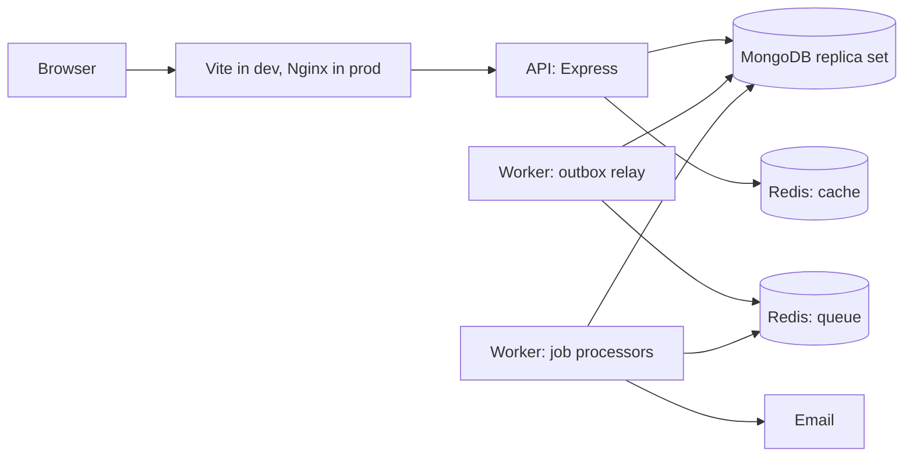

# Lumio Project Guide

How the Lumio Gold Trading ERP is built and how to work on it. For a description of every file, see the [file reference](FILE-REFERENCE.md). For what is finished and what is not, see the [production readiness checklist](production-readiness.md).

The documents under `docs/architecture`, `docs/database` and `docs/business-rules` describe the intended design. This guide describes the code as it stands. [Section 13](#13-where-the-code-differs-from-the-design-documents) lists the differences.

## 1. What Lumio is

Lumio is a multi-company ERP for gold traders, jewellers and bullion dealers. It handles buying and selling gold by weight and purity, stock, double-entry accounting, VAT, KYC and AML review, and reporting.

**Status:** the core workflow runs end to end in development. It is not ready for production, and several modules from the original brief are not built.

## 2. Technology

| Layer           | Technology                                                                          |
| --------------- | ----------------------------------------------------------------------------------- |
| Frontend        | React 19, TypeScript, Vite, Tailwind CSS, TanStack Query, React Hook Form, Recharts |
| Backend         | Node 22, Express 5, TypeScript, Mongoose 9, Zod 4, Pino                             |
| Data            | MongoDB 8 replica set, two Redis instances (cache and queue)                        |
| Background jobs | BullMQ, with a transactional outbox                                                 |
| Security        | Argon2id, JWT (jose), TOTP MFA, AES-256-GCM field encryption, Helmet                |
| Decimal maths   | decimal.js in code, `Decimal128` in the database, strings in JSON                   |
| Testing         | Vitest, Supertest, Testcontainers, fast-check, React Testing Library, Playwright    |
| Delivery        | Docker Compose, GitHub Actions, Nginx                                               |

TypeScript is held at version 6 because `typescript-eslint` does not support version 7 yet.

## 3. Running the project

### With Docker

```bash
docker compose up --build
docker compose --profile seed run --rm seed   # second terminal, creates the demo company
```

Open http://localhost:5173 and sign in as `admin@demo.lumio.local` with `demo-only-change-me`.

The demo company has a chart of accounts, a branch, a warehouse, cash and bank accounts and payment methods. Before you can transact, add purities, products, parties, tax codes, tax rules and a gold rate.

If a port is taken, set any of these before running Compose: `MONGO_HOST_PORT`, `REDIS_CACHE_HOST_PORT`, `REDIS_QUEUE_HOST_PORT`, `API_HOST_PORT`, `FRONTEND_HOST_PORT`.

| Service        | Default address                |
| -------------- | ------------------------------ |
| Web app        | http://localhost:5173          |
| API            | http://localhost:4000          |
| API docs       | http://localhost:4000/api/docs |
| Email capture  | http://localhost:8025          |
| Object storage | http://localhost:8333          |

### Commands

| Command                    | Purpose                                                                                   |
| -------------------------- | ----------------------------------------------------------------------------------------- |
| `npm run lint`             | ESLint                                                                                    |
| `npm run format:check`     | Prettier check (`npm run format` to fix)                                                  |
| `npm run typecheck`        | Strict TypeScript across all workspaces                                                   |
| `npm run boundaries`       | Module boundary and circular dependency rules                                             |
| `npm run openapi:generate` | Rewrites `docs/api/openapi.json`                                                          |
| `npm run openapi:check`    | Fails if the committed API contract is out of date                                        |
| `npm run test:unit`        | Unit and component tests                                                                  |
| `npm run test:integration` | Backend tests on real MongoDB and Redis (needs Docker)                                    |
| `npx playwright test`      | Browser tests. Needs the stack running and seeded. Set `E2E_BASE_URL` if the port differs |
| `npm run build`            | Builds every package and app                                                              |

### Environment variables

| Variable                            | Required | Purpose                                                                        |
| ----------------------------------- | -------- | ------------------------------------------------------------------------------ |
| `NODE_ENV`                          | Yes      | `development`, `test`, `staging` or `production`                               |
| `MONGODB_URI`                       | Yes      | Must be a replica set, because postings use transactions                       |
| `REDIS_CACHE_URL`                   | Yes      | Rate limits                                                                    |
| `REDIS_QUEUE_URL`                   | Yes      | BullMQ. Needs `noeviction`                                                     |
| `CORS_ORIGINS`                      | Yes      | Comma-separated browser origins                                                |
| `JWT_ACCESS_SECRET`                 | Yes      | At least 32 characters                                                         |
| `ENCRYPTION_KEY`                    | Yes      | At least 32 characters. Losing it makes KYC numbers and MFA secrets unreadable |
| `BLIND_INDEX_KEY`                   | Yes      | At least 32 characters. Used to match encrypted identifiers                    |
| `PORT`, `WORKER_HEALTH_PORT`        | No       | Default 4000 and 4001                                                          |
| `LOG_LEVEL`                         | No       | Default `info`                                                                 |
| `TRUST_PROXY_HOPS`                  | No       | Set to 1 behind Nginx so client IPs are correct                                |
| `APP_URL`, `SMTP_URL`, `EMAIL_FROM` | No       | Links and sender for outgoing email                                            |
| `SENTRY_DSN`                        | No       | Error monitoring is off when empty                                             |

The app validates these at startup and refuses to start if one is wrong. In staging and production it also rejects any secret beginning `dev-only`.

## 4. How the system fits together



The code is a **modular monolith**: one codebase with two processes, the API and the worker. Each business domain is a folder in `apps/backend/src/modules/`, and other code should import it only through its `index.ts`. `npm run boundaries` enforces this.

### Life of a request

1. `correlation-id` gives the request an ID, which is logged and returned to the caller.
2. Health routes are answered here, before any limits apply.
3. Helmet, CORS, JSON parsing and cookie parsing run.
4. The general rate limiter runs for everything under `/api/v1`.
5. `authenticate` verifies the token, checks the session has not been revoked, loads the user's permissions and builds `req.ctx`.
6. `requirePermission` rejects the request if a permission is missing.
7. `validate` parses the input with a Zod schema into `req.validated`.
8. The handler calls a service, passing `ctx`. Services hold the business rules.
9. `sendSuccess` returns `{ data, meta }`. Any thrown error reaches `error-handler`, which returns `{ error }`.

## 5. Core concepts

### Request context

`RequestContext` (`shared/context.ts`) holds `companyId`, `userId`, `branchScope`, `permissions`, `correlationId` and an optional database `session`. It is built only from the verified token, never from request input, and is passed explicitly into services.

### Tenant isolation

Every tenant collection has a `companyId`. `tenantGuardPlugin` throws if a query, aggregation or bulk write reaches MongoDB without a concrete `companyId`, and it has no bypass. Collections that belong to the platform, such as `users` and `outboxEvents`, do not use it.

A record from another company returns 404, so its existence is not revealed. Branch-limited users are confined with `assertBranchAccess` and list filters.

### Money and weight

JavaScript numbers are never used for money or weight. Values are `decimal.js` objects in code, `Decimal128` in MongoDB and strings in JSON. `formatDecimal` in the frontend formats these strings without converting them. The one exception is the dashboard chart, because Recharts can only draw numbers. Those values are used for drawing only.

### The calculation engine

`packages/calc-engine` is a pure library for all gold arithmetic. It takes decimal strings and an explicit policy, and returns results with a step-by-step `trace` that is stored on each invoice line.

The important rule is the **rate basis**:

- `FINE_GRAM`: value = fine weight × rate
- `PURITY_GRAM`: value = chargeable net weight × rate. The rate must be for the same purity as the line.

```
gross - stone                      = net weight
net + weight-based wastage         = chargeable weight
chargeable x fineness              = billed fine weight
rate (by basis)                    = gold value
+ value-based wastage + making + stones + other = gross line value
- discount, then VAT               = line total
```

Stock always moves by physical fine weight, calculated from net weight without wastage.

### Transactions

`runInTransaction` opens a snapshot-isolation, majority-write transaction. The driver can re-run the callback, so a callback must never send email or call an outside service. Operations inside one transaction must run one at a time, never in `Promise.all`, because a session cannot run them in parallel.

### Idempotency

Commands that move money or stock require an `Idempotency-Key` header. `executeIdempotent` claims the key inside the same transaction as the work. A repeat with the same body returns the first response, and a repeat with a different body returns 422.

### Outbox

Side effects are written to `outboxEvents` inside the business transaction. The worker's `OutboxRelay` moves them to BullMQ, and `handlers.ts` processes them. Failed jobs retry with backoff and then go to a dead-letter queue. Delivery can happen more than once, so handlers must be safe to repeat.

### Immutability

Journals, stock movements, payment allocations, tax transactions, gold rates and audit logs use `appendOnlyPlugin`, which refuses updates and deletes. Corrections are new records, such as a reversing journal. `infrastructure/mongo/create-app-user.js` adds the same restriction at database level, but it has not been run yet.

### Numbering

`allocateNumber` issues invoice numbers inside the posting transaction, so an aborted posting leaves no gap. The scope (company, branch, with or without fiscal year) is a company setting.

## 6. What happens when a sale is posted

`postDocument` in `modules/trade/trade.service.ts` does all of this in one transaction, inside `executeIdempotent`:

1. Loads the invoice and checks its status and approval requirement.
2. Allocates the invoice number.
3. Removes stock. Tagged pieces are claimed individually. Lots are relieved oldest first, and the lots used are stored on the line so a return can restore them.
4. Posts the journal: Dr Receivable, Dr Discounts, Cr Making income, Cr Gold sales, Cr Output VAT, Dr Cost of sales, Cr Inventory. The period must be open.
5. Records tax transactions.
6. Creates the open item and raises the party's balance.
7. Records any payments taken at the same time, allocated to that open item.
8. Checks the credit limit against the final balance.
9. Marks the invoice posted, with a content hash.
10. Writes the audit record and the `sale.posted` event.

If any step fails, none of it happens. After commit, the worker screens the sale against compliance rules.

Purchases run the same code in the other direction: stock comes in, with Dr Inventory, Dr Input VAT, Cr Payable. On a reverse-charge purchase the invoice shows no VAT, and the journal books the notional amount to both Input and Output VAT.

Pricing happens in `modules/trade/pricing.service.ts`. It resolves the product, purity, rate, charges and tax treatment, and the server's figures are the only ones stored.

## 7. Backend modules

| Module                 | Responsibility                                                                  |
| ---------------------- | ------------------------------------------------------------------------------- |
| `platform/audit`       | Audit log writer, with sensitive values redacted                                |
| `platform/crud`        | Reusable list, read, create, update and archive endpoints for master records    |
| `platform/idempotency` | Duplicate-request protection                                                    |
| `platform/numbering`   | Gapless document numbers                                                        |
| `platform/outbox`      | Reliable event capture and relay                                                |
| `identity`             | Login, MFA, sessions, password reset, invitations, users                        |
| `access`               | Roles and effective permissions                                                 |
| `organisation`         | Companies, settings, branches, warehouses, departments, employees               |
| `onboarding`           | Sets up a new company with roles, chart of accounts, periods and accounts       |
| `master`               | Parties, products, purities, party pricing                                      |
| `pricing`              | Gold rate entry, approval, history and lookup                                   |
| `tax`                  | Tax codes, rules, determination and tax transactions                            |
| `ledger`               | Chart of accounts, journal posting and reversal, financial periods              |
| `inventory`            | Balances, movements, lots, pieces, adjustments, transfers, reservations, counts |
| `finance`              | Cash and bank accounts, payments, allocations, open items, party balances       |
| `trade`                | Sales and purchase invoices, returns, credit notes, purchase orders             |
| `compliance`           | KYC records, rules, screening and cases                                         |
| `reporting`            | Dashboard, financial statements, report catalogue, CSV export                   |
| `health`               | Liveness and readiness                                                          |

## 8. API reference

All paths below are under `/api/v1` unless shown otherwise. Success responses are `{ data, meta }`, and failures are `{ error: { code, message, details, correlationId } }`. Decimals are always strings.

`docs/api/openapi.json` and Swagger UI currently describe the health endpoints only.

### Authentication

| Method and path                                   | Purpose                                             |
| ------------------------------------------------- | --------------------------------------------------- |
| `POST /auth/login`                                | Sign in. Returns a token or an MFA challenge        |
| `POST /auth/mfa`                                  | Complete an MFA challenge                           |
| `POST /auth/refresh`                              | Rotate the session. Needs `X-Requested-With: lumio` |
| `POST /auth/logout`                               | End the session                                     |
| `POST /auth/forgot-password`                      | Request a reset email                               |
| `POST /auth/reset-password`                       | Set a password from an invite or reset token        |
| `GET /auth/me`                                    | Current user and permissions                        |
| `POST /auth/change-password`                      | Change own password                                 |
| `POST /auth/mfa/enrol`, `/confirm`, `/disable`    | Manage MFA                                          |
| `GET /auth/sessions`, `DELETE /auth/sessions/:id` | List or revoke sessions                             |

### Standard record endpoints

Each path below supports `GET /`, `GET /:id`, `POST /`, `PATCH /:id` and `DELETE /:id` (archive). Lists accept `page`, `limit`, `sort`, `q` and listed filters.

`/branches`, `/warehouses`, `/departments`, `/employees`, `/parties`, `/party-pricing`, `/purities`, `/products`, `/payment-methods`, `/financial-accounts`, `/ledger-accounts`, `/tax-codes`, `/tax-rules`, `/compliance-rules`, `/kyc-records`

### Sales and purchases

The same endpoints exist under `/sales-invoices` and `/purchase-invoices`.

| Method and path                | Purpose                                                     |
| ------------------------------ | ----------------------------------------------------------- |
| `GET /`                        | List, with `status`, `partyId`, `branchId`, `page`, `limit` |
| `POST /quote`                  | Calculate without saving                                    |
| `POST /`, `PUT /:id`           | Create or edit a draft                                      |
| `GET /:id`                     | Full document                                               |
| `POST /:id/submit`             | Send for approval, or mark approved if none is needed       |
| `POST /:id/approve`, `/reject` | Decide. The creator cannot decide their own document        |
| `POST /:id/void`               | Discard a draft                                             |
| `POST /:id/post`               | Post. **Needs `Idempotency-Key`**                           |
| `POST /:id/returns`            | Return whole lines. **Needs `Idempotency-Key`**             |
| `GET /:id/credit-notes`        | Credit notes for this document                              |

### Stock

| Method and path                                                  | Purpose                      |
| ---------------------------------------------------------------- | ---------------------------- |
| `GET /stock/balances`, `/items`, `/lots`, `/movements`           | Current position and history |
| `POST /stock/receipts`, `/stock/issues`                          | Move stock manually          |
| `GET`, `POST /stock/adjustments`; `POST /:id/approve`, `/reject` | Approved adjustments         |
| `GET`, `POST /stock/transfers`; `POST /:id/dispatch`, `/receive` | Transfers                    |
| `GET`, `POST /stock/reservations`; `POST /:id/release`           | Reservations                 |
| `GET`, `POST /stock/counts`; `POST /:id/approve`                 | Physical counts              |

### Finance and accounting

| Method and path                                                      | Purpose                                    |
| -------------------------------------------------------------------- | ------------------------------------------ |
| `GET`, `POST /payments`; `POST /payments/:id/reverse`                | Payments. Writes need `Idempotency-Key`    |
| `GET /open-items`, `/party-balances`                                 | Outstanding amounts                        |
| `GET`, `POST /purchase-orders`                                       | Purchase orders                            |
| `GET /journals`, `/journals/:id/lines`; `POST /journals/:id/reverse` | Posted journals                            |
| `GET`, `POST /journal-drafts`; `POST /:id/post`                      | Manual journals, posted by a second person |
| `GET /periods`; `POST /periods/year`                                 | Financial periods                          |
| `POST /periods/:id/begin-close`, `/complete-close`, `/reopen`        | Period close                               |

### Other

| Method and path                                                                                            | Purpose                           |
| ---------------------------------------------------------------------------------------------------------- | --------------------------------- |
| `GET`, `POST /gold-rates`; `GET /gold-rates/requests`; `POST /requests/:id/approve`, `/reject`             | Gold rates                        |
| `GET /dashboard`                                                                                           | Dashboard figures                 |
| `GET /statements/trial-balance`, `/profit-and-loss`, `/balance-sheet`, `/cash-flow`, `/general-ledger/:id` | Statements                        |
| `GET /reports`, `/reports/:key` (`?format=csv` to export)                                                  | Report catalogue                  |
| `GET /compliance-cases`; `POST /compliance-cases/:id/decision`                                             | AML review                        |
| `GET`, `POST /users`; `PATCH /users/:id`                                                                   | Users                             |
| `GET`, `POST /roles`; `PATCH /roles/:id`; `GET /roles/permissions`                                         | Roles                             |
| `GET`, `PATCH /company`                                                                                    | Company settings                  |
| `GET /audit-logs`                                                                                          | Audit log                         |
| `POST /platform/companies`                                                                                 | New company, platform admins only |
| `GET /healthz/live`, `/healthz/ready`, `/healthz/startup` (no `/api/v1` prefix)                            | Health                            |

## 9. Roles and permissions

Permission keys look like `sale:post` and are defined in `packages/shared-types/src/permissions.ts`. The API enforces them, and the UI uses the same keys to hide what a user cannot do.

Each new company starts with nine editable roles: Company Administrator, Branch Manager, Accountant, Sales Manager, Sales Executive, Purchase Manager, Inventory Manager, Storekeeper and Auditor. Platform administrators are a separate flag on the user, not a company role.

Assigning a role with an empty branch list gives company-wide access. Listing branches limits the user to them.

`financials:view_cost` controls whether cost and margin appear in responses.

## 10. Frontend

| Route                                                                                    | Page                         |
| ---------------------------------------------------------------------------------------- | ---------------------------- |
| `/login`, `/forgot-password`, `/reset-password`, `/accept-invite`                        | Public auth pages            |
| `/`                                                                                      | Dashboard                    |
| `/sales`, `/sales/new`, `/sales/:id`                                                     | Sales invoices               |
| `/purchases`, `/purchases/new`, `/purchases/:id`                                         | Purchase invoices            |
| `/customers`, `/suppliers`, `/products`, `/purities`                                     | Master data                  |
| `/gold-rates`                                                                            | Rates and approvals          |
| `/stock`, `/stock/adjustments`, `/stock/transfers`, `/stock/movements`                   | Inventory                    |
| `/payments`, `/accounts`, `/payment-methods`                                             | Finance                      |
| `/journals`, `/chart-of-accounts`, `/periods`, `/statements`, `/tax-codes`, `/tax-rules` | Accounting                   |
| `/reports`                                                                               | Report viewer and CSV export |
| `/kyc`, `/compliance/cases`, `/compliance/rules`, `/audit-log`                           | Compliance                   |
| `/branches`, `/warehouses`, `/departments`, `/employees`                                 | Organisation                 |
| `/users`, `/roles`, `/company`, `/security`, `/system-status`                            | Administration               |

- **Server data** lives in TanStack Query.
- **Session and theme** live in React Context.
- **The access token** is held in memory only. The refresh token is in an HttpOnly cookie, and `refreshSession` shares one refresh among concurrent requests.
- **`ResourcePage`** builds a complete list, search, create, edit and archive screen from a field list. Most master-data screens are short configurations in `master-pages.tsx`.

## 11. Testing

| Layer       | Location                                | Notes                                                         |
| ----------- | --------------------------------------- | ------------------------------------------------------------- |
| Unit        | `*.test.ts` in packages and the backend | Includes property tests of the engine                         |
| Component   | `*.test.tsx` in the frontend            | Currently the system status page only                         |
| Integration | `*.int.test.ts`                         | Real MongoDB replica set and Redis, started by Testcontainers |
| Browser     | `e2e/`                                  | Runs against a live, seeded stack                             |

`apps/backend/src/erp-flow.int.test.ts` is the main business test. Its `assertBooksBalance` helper checks that debits equal credits and that stock balances equal the sum of their movements.

## 12. How to extend the system

### Add a master record

1. Add its Zod schema to `packages/validation/src/domain.ts`.
2. Add its model using `tenantSchema` and `tenantModel`, then import the module in `database/migrations/index.ts` if it is new.
3. Add permission keys in `permissions.ts`, and include them in roles as needed.
4. Mount it with `crudRouter` in `routes/index.ts`.
5. Add a `ResourcePage` configuration in `master-pages.tsx`, then a route in `app.tsx` and a link in `app-shell.tsx`.
6. Add a new migration entry so its collection and indexes are created. Never edit a migration that has shipped.

### Add a report

Add an entry to `REPORTS` in `modules/reporting/catalogue.ts`. It appears in the Reports page and supports CSV automatically. Apply `range.branchId` so branch-limited users stay confined.

### React to a posted event

Add a handler to `createHandlers` in `apps/worker/src/handlers.ts`. It must be safe to run twice for the same event.

### Change a posting rule

Journal lines are built in `journalLines` and `returnLines` in `trade.service.ts`, using account roles that each company maps in its chart of accounts. Any change needs accountant review and an updated test.

### Change the calculation engine

Increase `ENGINE_VERSION`, and add test cases for the new behaviour. Invoices keep the version and trace that priced them.

## 13. Where the code differs from the design documents

| Design document says                              | The code does                                                            |
| ------------------------------------------------- | ------------------------------------------------------------------------ |
| `postingProfiles` map events to accounts          | Accounts carry a `systemRole` such as `AR` or `INVENTORY`                |
| `approvalPolicies` and `approvalRequests`         | Simple thresholds in company settings, with statuses on each document    |
| `storageLocations` collection                     | A free-text `location` on stock, such as `MAIN`, `RETURNS`, `IN_TRANSIT` |
| `partyCategories` collection                      | A text `category` on the party                                           |
| Versioned `companySettings` and `pricingPolicies` | One embedded settings object per company                                 |
| `ledgerRollups` for fast reporting                | Statements aggregate journal lines directly                              |
| Audit sealing and a nightly integrity job         | Not built                                                                |
| Database role enforces immutability               | Application plugin only. The role script exists but has not been run     |
| Multi-currency journals                           | Journals are in one currency                                             |
| Client preview using `calc-engine`                | The Calculate button uses the server's `/quote`                          |
| Headless Chromium PDFs                            | Browser print only                                                       |
| Cursor pagination for ledgers                     | Fixed limits of 200 or more on those lists                               |
| Refresh token checked through Redis               | Session checked in MongoDB on each request                               |

## 14. Troubleshooting

| Problem                                | Likely cause and fix                                                                   |
| -------------------------------------- | -------------------------------------------------------------------------------------- |
| `ports are not available` from Compose | Another program holds the port. Set the matching `*_HOST_PORT` variable                |
| App refuses to start                   | The message names the invalid environment variable                                     |
| `No gold rate is available`            | Enter a rate in the invoice's currency                                                 |
| `No tax rule matches this line`        | Add a tax code and a tax rule. Lumio will not assume a treatment                       |
| `Tax code ... has not been verified`   | Mark the code verified after adviser review, or change the company setting             |
| `No financial period covers this date` | Create periods for that year on the Periods page                                       |
| `The period ... is closed`             | Post in an open period, or reopen it with authorisation                                |
| `not enough stock`                     | Check available weight in that warehouse and location. Returned goods sit in `RETURNS` |
| A document cannot be approved          | The creator cannot approve their own document. Use a second user                       |
| Integration tests fail to start        | Docker must be running                                                                 |
| Requests return 429                    | Rate limit reached. In development, flush the `redis-cache` service                    |
