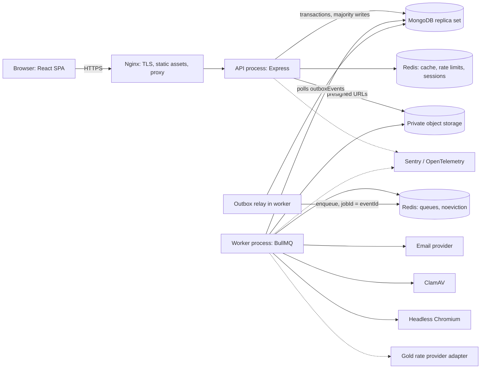
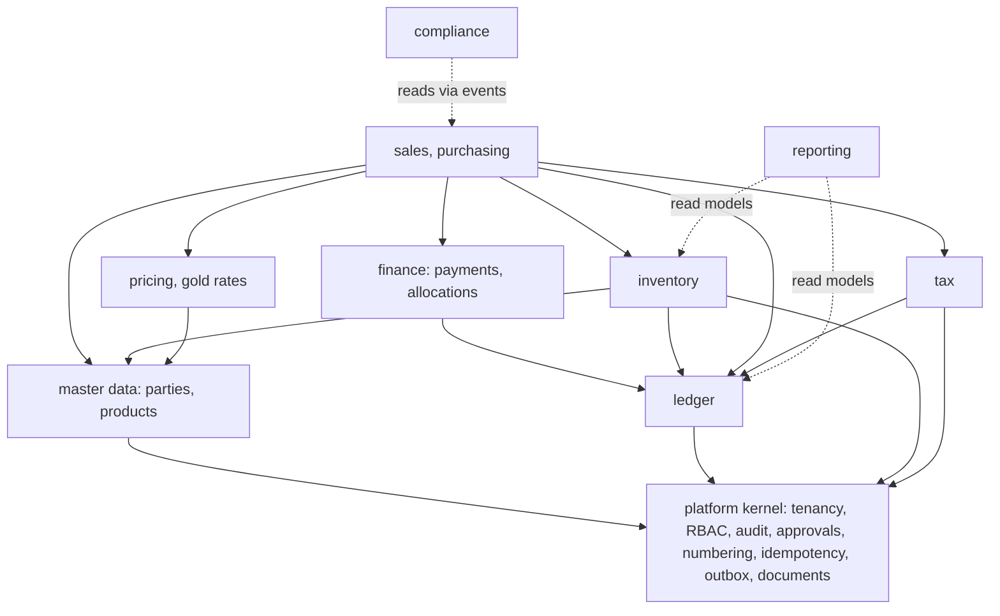

# 1. System Architecture

## 1.1 Shape of the system

A **modular monolith** with two runtime processes built from one codebase: the API and the worker.



**Why these shapes.**

- **Monolith, not services.** Posting a sale must change stock, ledger, tax and receivables atomically.
  Inside one process that is a single MongoDB transaction. Across services it becomes a saga with compensating
  financial entries, which is the failure mode this product exists to avoid.
- **Worker separate from API.** PDF rendering, virus scanning and exports must not take CPU from request handling.
  It also scales independently, and only its image carries Chromium.
- **Two Redis logical instances.** BullMQ requires `noeviction`; a cache wants `allkeys-lru`. Sharing one instance forces
  a choice where either queued jobs can be evicted or the cache can fill memory and fail writes.

## 1.2 Monorepo layout

Based on the brief's structure, rooted at this `Lumio` directory, using npm workspaces and package scope `@lumio/*`.

```
apps/
  frontend/                 React SPA
  backend/src/
    config/  database/  middleware/  routes/  events/  jobs/  shared/
    modules/<module>/       routes, controller, service, repository, model, validators, events, tests
    modules/<module>/index.ts   the ONLY import surface for other modules
    app.ts  server.ts
  worker/src/               thin composition root: queues, processors, outbox relay; imports backend module surfaces
packages/
  shared-types/             Permission keys, enums, DTO types
  validation/               Zod schemas: the API contract source
  calc-engine/              Pure decimal calculation engine (added)
  shared-utils/             Dates, formatting, Decimal helpers
infrastructure/  docker/ nginx/ monitoring/
docs/
```

## 1.3 Module boundaries

Layering inside a module: `route → controller → service → repository → model`.
Controllers parse, call one service method and shape the response. All rules live in services.

Dependencies between modules point one way, enforced in CI by `dependency-cruiser`:



**Two communication rules.**

1. **Synchronous service calls, sharing the transaction,** whenever a change must be atomic: stock, ledger, tax, sub-ledger.
   The `session` travels in an explicit `RequestContext` argument.
2. **Events through the transactional outbox** for everything that can lag: PDF, email, notifications, AML evaluation, rollups.

The ledger is never updated by an event. If the books lag the business document, "every transaction is traceable" stops being
provable at any moment in time.

## 1.4 Multi-tenancy

Shared database and collections, with `companyId` on every tenant document, and `branchId` on branch-scoped ones. Three layers:

1. **`RequestContext`** (`companyId`, `allowedBranchIds`, `permissions`, `userId`, `session`, `correlationId`) is built by
   middleware from verified auth only, never from request parameters. It is a required argument on every repository method.
2. **Repository base class** injects tenant filters and places a tenant `$match` first in any aggregation.
3. **Mongoose guard plugin** throws on any query that reaches the driver without `companyId`. This is the backstop.

`$lookup`, `$graphLookup` and `$unionWith` are rejected at runtime by the guard unless their definition includes a tenant condition.
Every unique index is prefixed with `companyId`. Tenant isolation is tested per endpoint (see [testing](06-testing-strategy.md)).

Database-per-tenant was rejected: it multiplies migrations and connection pools with no gain at this scale. It remains reachable later,
because all access passes through the repository layer.

## 1.5 Decision record

| ID     | Decision                                                                                                                             | Rejected alternative                             | Reason                                                                                                          |
| ------ | ------------------------------------------------------------------------------------------------------------------------------------ | ------------------------------------------------ | --------------------------------------------------------------------------------------------------------------- |
| ADR-01 | Modular monolith                                                                                                                     | Microservices                                    | Atomic posting; team size; brief                                                                                |
| ADR-02 | Business posting, stock and ledger in one transaction                                                                                | Event-driven ledger                              | Books must never disagree with documents                                                                        |
| ADR-03 | Transactional outbox polled by the worker                                                                                            | Publish after commit                             | Publishing after commit loses events on a crash. Polling is simpler to operate than change-stream resume tokens |
| ADR-04 | Posted journals, stock movements, audit log and rates are insert-only collections, with **the app DB user denied update and delete** | Application convention only                      | Immutability enforced by the database survives application bugs                                                 |
| ADR-05 | Drafts live apart from posted journals (`journalDrafts` vs `journalEntries`)                                                         | Status field in one collection                   | Makes ADR-04 possible                                                                                           |
| ADR-06 | `decimal.js` in the engine, `Decimal128` in storage, decimal **strings** in JSON                                                     | Integer minor units; JSON numbers                | Weights and rates need varying scales; JSON numbers parse to floats in every browser                            |
| ADR-07 | Shared `calc-engine` package; the server result is authoritative                                                                     | Separate client calculation                      | One implementation, and previews that match invoices                                                            |
| ADR-08 | Single `parties` collection with customer and supplier profiles                                                                      | Two collections                                  | One KYC record, one AML aggregate, netting possible                                                             |
| ADR-09 | Stock uses a movement ledger plus a balance projection, updated by conditional write in the same transaction                         | Summing the ledger on each read; read-then-write | Fast reads and race-free oversell prevention                                                                    |
| ADR-10 | Shared-collection tenancy, three enforcement layers                                                                                  | DB per tenant                                    | See 1.4                                                                                                         |
| ADR-11 | Zod schemas in `packages/validation` generate OpenAPI                                                                                | Hand-written spec                                | The contract cannot drift from validation                                                                       |
| ADR-12 | Access token in memory, rotating refresh token in HttpOnly cookie                                                                    | Both in cookies; localStorage                    | CSRF surface reduced to one endpoint; tokens unreachable by XSS persistence                                     |
| ADR-13 | Two-phase period close (`CLOSING`, drain, `CLOSED`)                                                                                  | Counter on the period document                   | Avoids a company-wide write hot spot; see [consistency](03-consistency-strategy.md)                             |
| ADR-14 | HTML-to-PDF via headless Chromium in the worker                                                                                      | Programmatic PDF libraries                       | Arabic shaping and RTL render correctly for bilingual invoices                                                  |
| ADR-15 | Issued PDFs stored once with a content hash                                                                                          | Re-render on demand                              | A template change must never alter an issued invoice                                                            |
| ADR-16 | Field-level AES-256-GCM with a key-provider interface, HMAC blind index for exact search                                             | MongoDB automatic client-side encryption         | Automatic CSFLE needs Enterprise or Atlas tooling; this keeps hosting open                                      |
| ADR-17 | `mongoose.sanitizeFilter` plus strict Zod schemas for NoSQL injection                                                                | `express-mongo-sanitize`                         | That middleware assigns to `req.query`, which is read-only in Express 5                                         |

## 1.6 Cross-cutting kernel (built first)

Tenancy context, RBAC, audit writer, approval engine, number series, idempotency, outbox, document storage, decimal utilities,
and a typed error hierarchy with central handling. These are small and every module relies on them.
