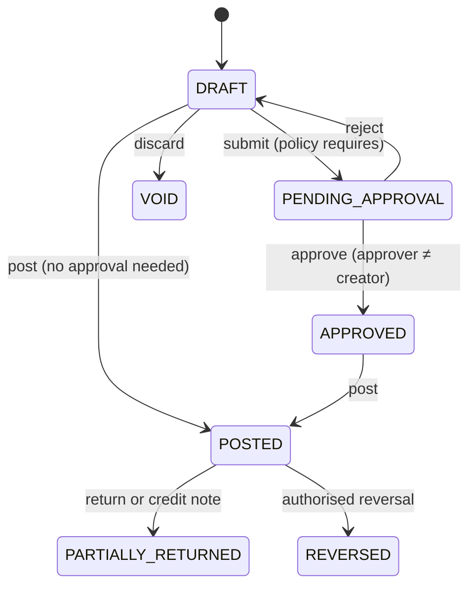

# 6. Critical Business Workflows

Entries below assume the default account mapping; real mappings are configurable in `postingProfiles` and must be signed off by your accountant.

## 6.1 Document lifecycle

Business numbers are allocated **at posting**, so abandoned drafts leave no gaps. A posted document is corrected only by a return, credit note or reversal.

## 6.2 Sale

1. Select customer. KYC status, sanctions result, credit position and risk flags are shown.
2. Add lines by barcode, piece or product. Enter weights and purity.
3. Server resolves the applicable rate, policy, party pricing and tax treatment; returns a calculated quote. Rate is locked per [Q7](03-risks-and-open-questions.md).
4. Discounts above the authorised limit trigger approval.
5. Submit, approve where required, post.

**Posting transaction (all or nothing):** claim idempotency key → compare-and-set status → assert period open → re-validate rate and totals →
conditional stock decrement → allocate invoice number → journal → tax transaction → open item and party balance with credit-limit check →
audit → outbox event → complete idempotency key.

|         | Debit              | Credit                                 |
| ------- | ------------------ | -------------------------------------- |
| Revenue | Cash or Bank or AR | Gold Sales; Making Revenue; Output VAT |
| Cost    | Cost of Goods Sold | Inventory                              |

**After commit, via outbox:** PDF rendered and stored, receipt emailed, AML rules evaluated, notifications sent, rollups updated.

Immediate payment is recorded inside the same transaction. One invoice can take several payment methods.

## 6.3 Purchase

Order (optional) → goods receipt with actual weight and assay → invoice → payment.

- **Goods receipt and invoice can be separate.** Stock enters at receipt, at estimated cost, against a Goods Received Not Invoiced account. The invoice clears it and any price difference posts per policy.
- For the simple case the two post together, matching the brief's sequence.
- A supplier invoice number duplicated for the same supplier is rejected by a unique index.

|                  | Debit                | Credit             |
| ---------------- | -------------------- | ------------------ |
| Combined posting | Inventory; Input VAT | Cash or Bank or AP |

Old-gold purchase from a walk-in customer uses the same flow with the party in a supplier role, and captures assay plus identity documents per compliance rules.

## 6.4 Payment and allocation

A receipt or payment posts `Dr Bank / Cr AR` (or the reverse for AP), then allocates to specific open items, oldest first by default, or manually.
Unallocated residue remains on the party as an on-account credit. Reversal creates a reversing journal and reversing allocations and restores outstanding amounts.
Duplicate payments are blocked by the `Idempotency-Key`, plus a soft warning on matching party, amount, reference and date.

## 6.5 Returns, credit notes, refunds

- Reference the original line. Returned quantity cannot exceed the unreturned quantity, enforced at posting.
- Reverses at the **original snapshot** rate, tax and cost, unless your policy says otherwise ([Q11](03-risks-and-open-questions.md)).
- Stock returns to a quarantine location pending inspection. A refund is a separate payment, allocated against the credit note.

## 6.6 Inter-branch transfer

Request → approve → **dispatch** (source decrements, in-transit location increments, atomically) → **receive** (in-transit decrements, destination increments).
Weight differences at receipt create a variance adjustment requiring approval. Within one company the movement is value-neutral at company level, and posts through
an inter-branch clearing account when branch-level balance sheets are enabled.

## 6.7 Stock adjustment and physical count

Count snapshots book quantities → blind entry of counted weights → variance review → approved adjustment with reason code → movement and journal (`Inventory` vs `Stock Gain/Loss`).
Movements occurring during a count are tracked so that the variance compares like with like.

## 6.8 Gold rate publication

Entry or provider fetch → `goldRateRequests` → approval where policy requires → insert into `goldRates`. Rows are never updated. A correction is a newer row.
Historical invoices hold their own snapshots, so they are unaffected.

## 6.9 Period close

Readiness checks (unposted drafts, unreconciled accounts, integrity job clean) → `CLOSING` (blocks new postings) → drain → verify → closing entries → `CLOSED`.
Reopening requires a specific permission, a reason, and approval, and is audited.

## 6.10 Compliance review

Posted transaction event → rule engine evaluates configurable thresholds and aggregates at party level across roles → risk flag and case →
reviewer decision with rationale → regulatory report drafted for manual submission. Rules can also **block posting** when configured, via a synchronous pre-post check.
