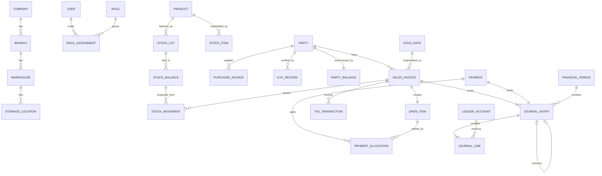

# 4–5. MongoDB Collections and Relationships

## 4.1 Conventions

- All tenant documents carry `companyId`. Branch-scoped documents also carry `branchId`.
- Money, weight, rate and fineness are `Decimal128`. `$sum` over `Decimal128` is exact.
- Timestamps are UTC `Date`. Business dates (`postingDate`) are stored separately from system timestamps.
- Mutable documents carry `version` for optimistic concurrency.
- Master data is soft-deleted (`archivedAt`). Financial and stock records are never deleted.

**Mutability classes**

| Code  | Meaning                                                           | Enforcement                                             |
| ----- | ----------------------------------------------------------------- | ------------------------------------------------------- |
| **A** | Append-only                                                       | MongoDB role grants `find` and `insert` only            |
| **V** | Versioned configuration: new row per change, with effective dates | Repository                                              |
| **D** | Editable while draft, frozen after posting                        | Status guard, `postedHash` checked by the integrity job |
| **M** | Mutable master data                                               | Audited updates                                         |
| **P** | Projection, rebuildable from A records                            | Written only by the owning service                      |
| **T** | Ephemeral, TTL-expired                                            | TTL index                                               |

## 4.2 Collections

Index notation: `c` = `companyId`, `U` = unique. Key fields are indicative; full schemas are specified per module at implementation.

### Organisation and identity

| Collection                 | Class | Key fields                                             | Key indexes                    |
| -------------------------- | ----- | ------------------------------------------------------ | ------------------------------ |
| `companies`                | M     | legalName, baseCurrency, taxProfile, status            | U(code)                        |
| `companySettings`          | V     | allowNegativeStock, numbering, rounding, effectiveFrom | (c, effectiveFrom)             |
| `branches`                 | M     | name, address, tax location                            | U(c, code)                     |
| `warehouses`               | M     | branchId, name, type                                   | U(c, code)                     |
| `storageLocations`         | M     | warehouseId, code (vault, tray, in-transit)            | U(c, warehouseId, code)        |
| `departments`, `employees` | M     | profile, userId, branchIds                             | U(c, employeeNo)               |
| `users`                    | M     | email, passwordHash, status, mfa (encrypted)           | U(emailNormalised)             |
| `roles`                    | M     | name, permissions[], isSystem                          | U(c, name)                     |
| `roleAssignments`          | M     | userId, roleId, scope (`company` or branchIds)         | (userId, c)                    |
| `sessions`                 | T     | userId, familyId, refreshHash, device, ip, expiresAt   | U(refreshHash), TTL(expiresAt) |
| `authTokens`               | T     | userId, purpose, tokenHash, expiresAt                  | U(tokenHash), TTL(expiresAt)   |
| `loginHistory`             | A     | userId, outcome, ip, device, at                        | (userId, at)                   |

### Master data and pricing

| Collection                    | Class | Key fields                                                                                              | Key indexes                                         |
| ----------------------------- | ----- | ------------------------------------------------------------------------------------------------------- | --------------------------------------------------- |
| `parties`                     | M     | type, roles[], customerProfile, supplierProfile, taxReg, addresses[], creditLimit, idHash (blind index) | U(c, code), (c, idHash), text(name)                 |
| `partyCategories`             | M     | name, applies-to                                                                                        | U(c, name)                                          |
| `partyActivities`             | A     | partyId, type, note, userId                                                                             | (c, partyId, at)                                    |
| `partyPricingRules`           | V     | partyId or categoryId, making and discount overrides, dates                                             | (c, partyId, effectiveFrom)                         |
| `productCategories`           | M     | kind (raw, bar, bullion, coin, jewellery, scrap, recycled, other), tracking                             | U(c, code)                                          |
| `products`                    | M     | sku, barcode, categoryId, purityId, tracking (`PIECE`/`LOT`), reorder levels, default charges           | U(c, sku), U(c, barcode) sparse                     |
| `purities`                    | V     | label, karat, fineness (explicit), effectiveFrom                                                        | U(c, code, effectiveFrom)                           |
| `currencies`, `exchangeRates` | M, A  | minor unit; pair, rate, at, source                                                                      | (c, pair, at)                                       |
| `goldRates`                   | A     | purityId or `FINE`, value, unit, basis, currency, source, effectiveAt, approvedBy                       | (c, branchId, purityId, currency, effectiveAt desc) |
| `goldRateRequests`            | D     | proposed rates, status                                                                                  | (c, status)                                         |
| `pricingPolicies`             | V     | making and wastage modes, rounding profile, version                                                     | U(c, code, version)                                 |

### Inventory

| Collection          | Class | Key fields                                                                                                          | Key indexes                                                       |
| ------------------- | ----- | ------------------------------------------------------------------------------------------------------------------- | ----------------------------------------------------------------- |
| `stockLots`         | M     | lotNo, productId, purityId, supplier, assay, source doc                                                             | U(c, lotNo)                                                       |
| `stockItems`        | M     | serial piece: tag, weights, purity, locationId, status, cost                                                        | U(c, tag), (c, branchId, status)                                  |
| `stockBalances`     | P     | key (c, warehouse, location, product, lot, purity); pieces, gross, net, fine: onHand and reserved; avgCost; version | U(key)                                                            |
| `stockMovements`    | A     | type, key, signed quantities, unitCost, sourceDoc, reversesId, seq, at                                              | (c, productId, at), (c, sourceDoc), U(c, sourceDoc, lineId, type) |
| `stockReservations` | M     | sourceDoc, quantities, expiresAt, status                                                                            | (c, status, expiresAt)                                            |
| `stockTransfers`    | D     | from, to, lines, status, variance                                                                                   | U(c, number)                                                      |
| `stockAdjustments`  | D     | lines, reason, status                                                                                               | U(c, number)                                                      |
| `stockCounts`       | D     | scope, snapshotAt, status, lines                                                                                    | U(c, number)                                                      |

### Purchasing and sales

Lines are embedded: they are bounded (cap 500), always read with the header, and atomic with it.

| Collection         | Class | Key fields                                                         | Key indexes                                                                           |
| ------------------ | ----- | ------------------------------------------------------------------ | ------------------------------------------------------------------------------------- |
| `purchaseOrders`   | D     | supplierId, lines, status                                          | U(c, number) sparse, (c, partyId, date)                                               |
| `goodsReceipts`    | D     | poId, lines (assay and actual weight)                              | U(c, number) sparse                                                                   |
| `purchaseInvoices` | D     | supplierInvoiceNo, lines with snapshot, totals, status, postedHash | U(c, seriesId, number) partial, U(c, partyId, supplierInvoiceNo) partial              |
| `purchaseReturns`  | D     | originalInvoiceId, lines                                           | U(c, number) sparse                                                                   |
| `salesInvoices`    | D     | customerId, lines with snapshot, totals, status, postedHash        | U(c, seriesId, number) partial, (c, branchId, postingDate), (c, partyId, postingDate) |
| `salesReturns`     | D     | originalInvoiceId, lines, original cost                            | U(c, number) sparse                                                                   |
| `creditNotes`      | D     | kind (customer, supplier), reference, totals                       | U(c, seriesId, number) partial                                                        |

**Line snapshot** embedded on every invoice line: rateId, rate value, basis, unit, currency, FX rate, rate timestamp, source, purity and fineness used,
policy version, tax code version, engine version and full calculation trace. Reports never re-derive these from master data.

### Finance and ledger

| Collection           | Class | Key fields                                                                    | Key indexes                                                                                   |
| -------------------- | ----- | ----------------------------------------------------------------------------- | --------------------------------------------------------------------------------------------- |
| `financialAccounts`  | M     | kind (cash, bank, payment), currency, ledgerAccountId                         | U(c, code)                                                                                    |
| `paymentMethods`     | M     | name, financialAccountId, AML class                                           | U(c, code)                                                                                    |
| `payments`           | D     | direction, partyId, method, amount, status                                    | U(c, seriesId, number) partial, (c, partyId, date)                                            |
| `paymentAllocations` | A     | paymentId, openItemId, amount, reversesId                                     | (c, openItemId), (c, paymentId)                                                               |
| `openItems`          | P     | partyId, sourceDoc, original, outstanding, dueDate                            | U(c, sourceDoc), (c, partyId, status, dueDate)                                                |
| `partyBalances`      | P     | partyId, receivable, payable, money and metal                                 | U(c, partyId)                                                                                 |
| `bankStatementLines` | M     | accountId, date, amount, matchedTo                                            | U(c, accountId, externalId)                                                                   |
| `reconciliations`    | D     | accountId, range, status                                                      | (c, accountId, to)                                                                            |
| `ledgerAccounts`     | M     | code, class, type, cashFlowClass, isControl, parentId                         | U(c, code)                                                                                    |
| `postingProfiles`    | V     | event, conditions, debit and credit account rules                             | (c, event, effectiveFrom)                                                                     |
| `financialPeriods`   | M     | from, to, status (`OPEN`,`CLOSING`,`CLOSED`), history                         | U(c, from)                                                                                    |
| `journalDrafts`      | D     | manual entries awaiting approval                                              | (c, status)                                                                                   |
| `journalEntries`     | A     | number, postingDate, periodId, sourceDoc, totals, reversesEntryId             | U(c, seriesId, number), U(c, sourceDoc, kind), U(c, reversesEntryId) partial                  |
| `journalLines`       | A     | entryId, accountId, branchId, partyId, debit, credit, txn currency and amount | (c, accountId, postingDate), (c, branchId, accountId, postingDate), (c, partyId, postingDate) |
| `ledgerRollups`      | P     | (c, branch, account, period), debit, credit                                   | U(key)                                                                                        |

`U(c, reversesEntryId)` makes double reversal impossible without ever touching the original entry.
A `$expr` validator on `journalEntries` rejects `totalDebit != totalCredit` at the database.
Lines live in their own collection because the general ledger is queried by account and date across entries.

### Tax, compliance, workflow, platform

| Collection                      | Class | Key fields                                                             | Key indexes                               |
| ------------------------------- | ----- | ---------------------------------------------------------------------- | ----------------------------------------- |
| `taxCodes`                      | V     | rate, treatment, effective dates, verification status                  | U(c, code, effectiveFrom)                 |
| `taxRules`                      | V     | conditions → tax code, priority                                        | (c, priority)                             |
| `taxTransactions`               | A     | sourceDoc, direction, taxable, tax, treatment, period                  | (c, periodKey, direction)                 |
| `kycRecords`                    | V     | partyId, encrypted identifiers, status, expiry                         | (c, partyId), (c, expiresAt)              |
| `complianceRules`               | V     | trigger, threshold, action, legal reference                            | (c, trigger)                              |
| `riskFlags`, `complianceCases`  | M     | party, trigger doc, status, decision trail                             | (c, status)                               |
| `regulatoryReports`             | D     | type, period or transaction, submission reference                      | (c, type, status)                         |
| `approvalPolicies`              | V     | doc type, conditions, approver levels                                  | (c, docType)                              |
| `approvalRequests`              | M     | doc, requestedBy, steps, decisions                                     | (c, status, approverRole)                 |
| `documents`                     | M     | ownerRef, storageKey, sha256, mime, size, scanStatus, expiry, versions | (c, ownerRef), (c, expiresAt)             |
| `numberSeries`                  | M     | scope, prefix, next                                                    | U(c, scopeKey)                            |
| `auditLogs`                     | A     | actor, action, entity, before/after (redacted), correlationId, at      | (c, entity, at), (c, actor, at)           |
| `auditSeals`                    | A     | range, hash chain value                                                | U(c, seq)                                 |
| `idempotencyKeys`               | T     | c, userId, key, requestHash, state, response                           | U(c, userId, key), TTL(expiresAt)         |
| `outboxEvents`                  | T     | type, payload, status, attempts                                        | (status, nextAttemptAt), TTL(processedAt) |
| `notifications`                 | T     | userId, type, ref, readAt                                              | (userId, readAt, at), TTL                 |
| `reportJobs`, `reportSchedules` | M     | params, status, fileRef                                                | (c, requestedBy, at)                      |

TTLs on idempotency keys and outbox rows depend on your retention choice. Nothing subject to statutory retention carries a TTL.

## 5. Relationships

**Embed vs reference.** Embed where data is bounded and owned (invoice lines, addresses). Reference where it grows or is queried independently
(movements, journal lines, documents, activities). Snapshot, not reference, anything that must stay historically true (rates, tax, party name and TRN on an invoice).

**Migrations** use a versioned runner with a `migrations` changelog collection and an expand-then-contract discipline
(see [deployment](../deployment/01-docker-cicd-observability.md)).
