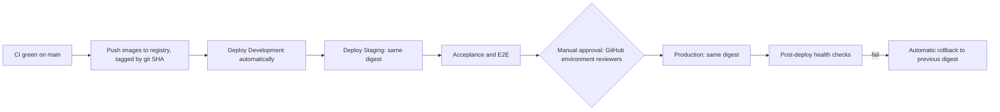

# 12. Docker, CI/CD and Observability

## 12.1 Images

| Image      | Base                                      | Contents                                |
| ---------- | ----------------------------------------- | --------------------------------------- |
| `frontend` | Multi-stage, ending in unprivileged Nginx | Static build, SPA fallback, CSP headers |
| `api`      | Multi-stage, slim Node, non-root          | Backend build, production deps only     |
| `worker`   | Same build stage, adds Chromium, non-root | Worker entry plus PDF rendering         |

Node and all packages are pinned to the then-current LTS and mutually compatible versions at Phase 2. Base images pinned by digest. No secrets at build time.

## 12.2 Compose

**Development: `docker compose up`**

`mongo` (single-node replica set with auto-init, since transactions require a replica set) · `redis-cache` · `redis-queue` (`noeviction`) · `object-storage` (SeaweedFS, S3-compatible) · `mailpit` (captures email) · `clamav` · `api` and `worker` (watch mode) · `frontend` (Vite). Named volumes, health checks, `depends_on: service_healthy`.

**Production: `docker-compose.prod.yml`**

`nginx` · `api` (replicas) · `worker` · a one-shot `migrate`. MongoDB is expected to be managed or a three-node replica set outside this file, since a single-container database is not acceptable for production. Redis likewise. Target platform depends on [Q17](../business-rules/03-risks-and-open-questions.md).

## 12.3 Continuous integration

`ci.yml`, on pull requests and pushes to `main` and `develop`:

```
install → lint → format check → typecheck → module boundary check → OpenAPI drift check
        → unit tests → integration tests (real replica set, Redis)
        → build frontend, backend, worker → npm audit and image scan → build and validate images
```

Every step is mandatory. Coverage thresholds apply to `calc-engine`, `ledger`, `inventory` and `finance`.

## 12.4 Continuous deployment



Images are built once and promoted by **digest**, so production runs precisely what was tested. Each environment has its own GitHub Environment secrets, and OIDC is preferred over long-lived cloud credentials.

## 12.5 Migrations and rollback

Migrations run as a one-shot job using a privileged credential the app does not hold. They follow **expand, migrate, contract**: new shape added, code handles both, old shape removed in a later release.
That is what makes image rollback safe: the previous version still understands the schema. A migration that is not backward compatible is blocked by review and needs a written plan.

Backup: point-in-time recovery on the database, daily encrypted snapshots, object-storage versioning, and a **scheduled restore test**. RPO and RTO need your input ([Q17](../business-rules/03-risks-and-open-questions.md)).

## 12.6 Observability

| Need            | Approach                                                                                        |
| --------------- | ----------------------------------------------------------------------------------------------- |
| Logs            | Pino JSON with correlation ID, tenant and user IDs, redaction allowlist                         |
| Errors          | Sentry, with PII scrubbing, on API, worker and frontend                                         |
| APM and latency | OpenTelemetry traces and RED metrics, exported to Prometheus and Grafana or a hosted equivalent |
| Database        | Slow-query profile, connection pool, replication lag, transaction abort rate                    |
| Jobs            | Queue depth, age, failure rate, DLQ size; an internal, permission-gated dashboard               |
| Health          | `/healthz/live` (process only), `/healthz/ready` (Mongo, Redis), `/healthz/startup`             |
| Alerts          | Integrity job failure, DLQ growth, error spikes, replication lag, stuck outbox, backup failure  |
| Shutdown        | SIGTERM: stop accepting work, finish requests and transactions, close queues and connections    |

## First deployment

Create the first platform administrator once, with the password passed through the environment so it never appears in a process list or shell history:

```bash
docker compose -f docker-compose.prod.yml run --rm \
  -e PLATFORM_ADMIN_EMAIL -e PLATFORM_ADMIN_NAME -e PLATFORM_ADMIN_PASSWORD \
  api node apps/backend/dist/database/create-platform-admin.js
```

That person signs in and creates companies under Platform, then Companies. The command refuses to run once an administrator exists.

Staging and production also need `CLAMAV_HOST`, a private `S3_BUCKET`, and the proxy in front of Nginx to set `X-Forwarded-Proto`. Set `METRICS_PORT` to expose Prometheus metrics, `SANCTIONS_UN_URL` for the nightly list refresh, and `PASSWORD_BREACH_CHECK=true` to check new passwords. To make audit seal exports tamper-resistant, enable object lock on the `audit-seals/` prefix.

## TLS, backups and the database role

TLS: add `infrastructure/tls/docker-compose.tls.yml` to the production stack, with `LUMIO_DOMAIN`, `LUMIO_TLS` set to an email address, and `TRUST_PROXY_HOPS=2`.

Backups: schedule `infrastructure/backup/backup.sh` with `MONGODB_URI`, `BACKUP_PASSPHRASE_FILE`, `BACKUP_DIR` and `BACKUP_S3_URI`. Keep the passphrase outside the backup location. Restore with `restore.sh`, then run `dist/database/verify-restore.js` to check the books. Drill this on a schedule.

Database role: after every migration, run `infrastructure/mongo/create-app-user.js` as an administrator. It is safe to repeat, and a collection added by a migration has no access until it runs. The application connects as that user; only migrations use the administrator.

Load: `infrastructure/load/smoke.js` runs with k6 against a non-production environment. It creates real payments. Raise `GENERAL_RATE_LIMIT` for the test, and consider it for offices where many users share one IP address.
